# obs-shaderfilter (xycoord's fork)

A shader filter for [OBS Studio](https://obsproject.com/): add it to any source, pick a shader, and adjust it. About
180 shaders come with it, among them complete film, VHS and CRT looks that are quick to get right without knowing
what every part does, and it runs shaders you write yourself.

| Film Look, Classic Film (16mm) | Film Look, Home Movie (Super 8) |
|---|---|
| 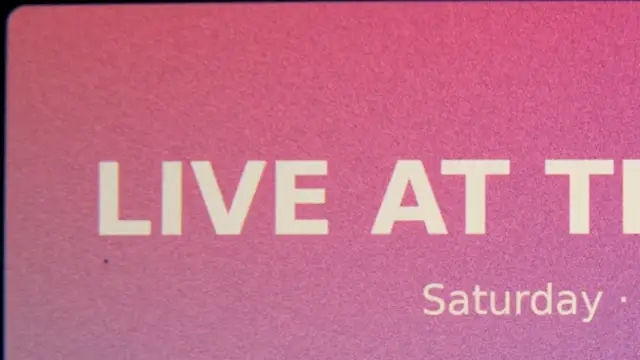 | 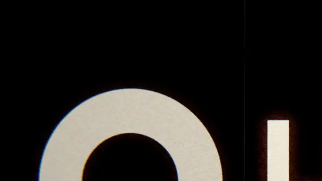 |

> **This is a fork** of [Exeldro's obs-shaderfilter](https://github.com/exeldro/obs-shaderfilter) (release 2.6.1),
> which grew from [nleseul's original plugin](https://github.com/nleseul/obs-shaderfilter). The plugin, the shader
> format and most of the bundled shaders are theirs and their contributors'; see [Credits](#credits). The fork isn't
> theirs: please report problems with it [here](https://github.com/xycoord/obs-shaderfilter/issues), not upstream.

## What this fork improves

### Presets that set the whole look
Choose a preset and every setting follows. Change anything and the list says so ("Classic Film (16mm) — changed"),
with the preset itself next to it: pick it to go back. A shader made of parts, such as Film Look, shows each part in a
box with a tick on its heading, so you can have the whole look without the dust; the ticks stay as you leave them
when you try another preset. The main settings come first, and the rest are behind **Show All Settings**.

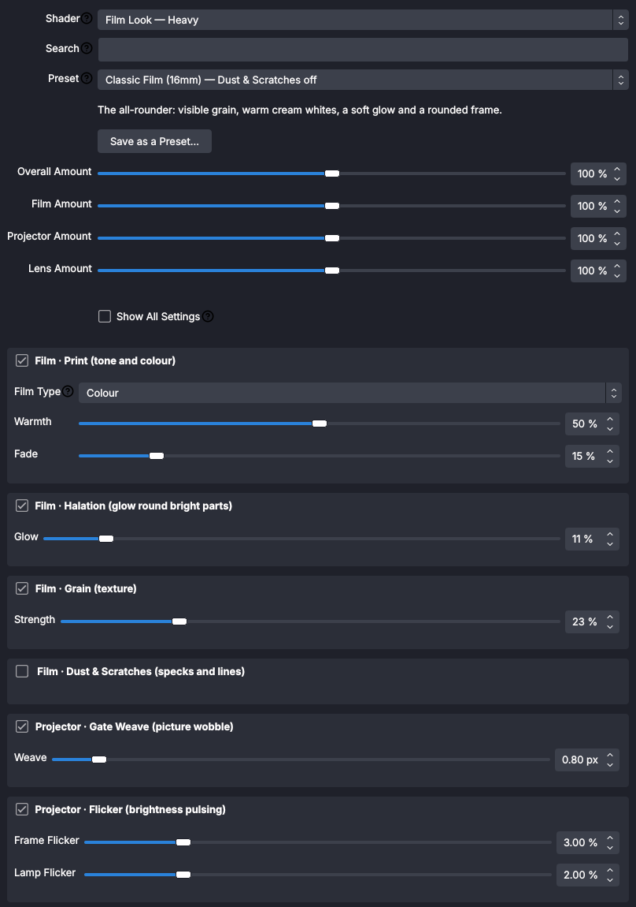

### Presets of your own, for any shader
**Save as a Preset…** keeps a filter's settings, part ticks included, under **Your presets** in the list, for every
filter using that shader. It works for every shader, with presets or without. Saving a changed preset of your own
under its name updates it; **Delete** removes it.

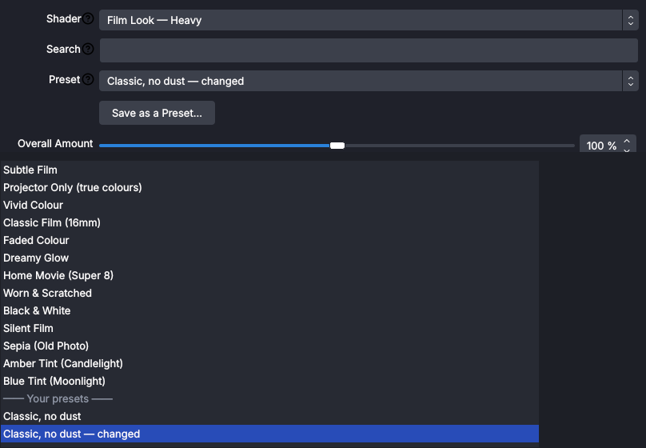

### Finding a shader
The Shader list starts with **Recently used**, then the shaders by category. **Search** matches names and categories
(film, blur, vhs…). 44 shaders that few people need (near-copies of another shader, jobs one of OBS's own filters
does, and demos) are listed last, under **More shaders**; they all still work. After choosing a shader, ↑/↓ on the
list steps through the others while you watch the preview. Filters are named after their shader.

| Recently used, then categories | Searching "film" |
|---|---|
| 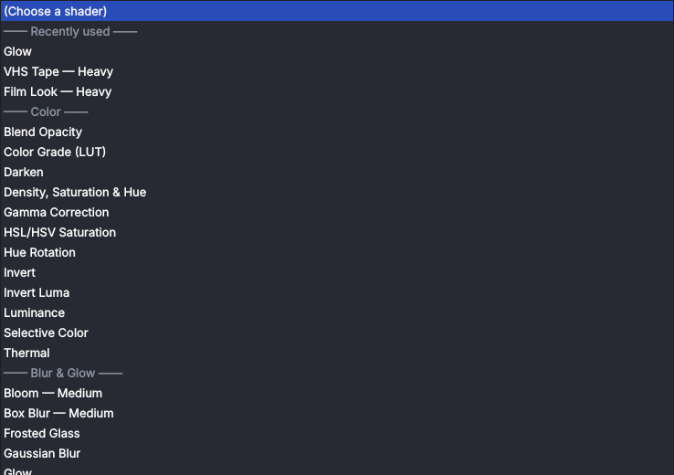 | 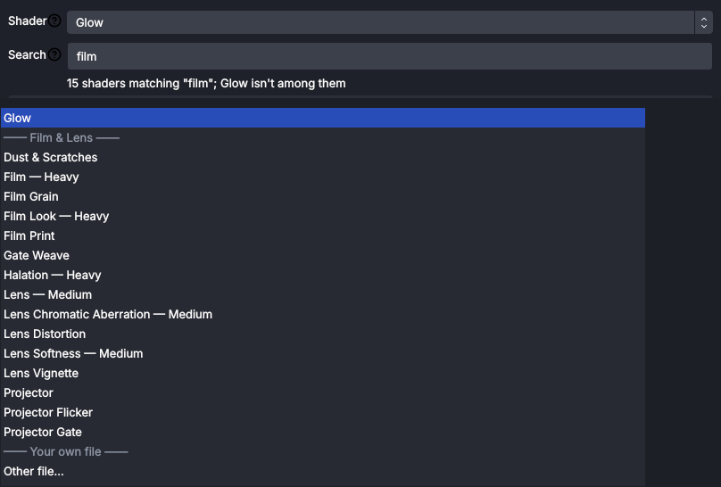 |

### Small things that add up
- **Units on numbers** (%, px, fps) and plain names for settings, in the new shaders.
- **What a shader costs:** the list marks shaders that take noticeably more GPU time (Medium, Heavy, Very Heavy), and
  a chosen shader's settings show the time it actually takes on your computer.
- **Switch to Film Look:** a Film, Projector or Lens filter (or any single part) becomes a Film Look keeping its
  settings; three of them in a row combine into one.
- **Clear errors:** a filter whose shader fails says why, and shows "⚠" before its name until it works again.

### Faster stacks of filters
Several shader filters on one source render much faster than in release 2.6.1, with the same output and no change
to your scenes: neighbouring shader filters hand their pictures straight to each other, and simple colour filters
are merged into the one before them. Five colour filters on one source went from 123 ms to 36 ms per frame in a
software-GPU test. [DEVELOPING.md](DEVELOPING.md#how-stacks-are-drawn) has the details.

Scenes saved with 2.6.1 keep working, including filters with their shader code typed in.

## New shaders

26 shaders are new in this fork, in two packs. Each pack has an all-in-one filter with presets and one Amount, and
each part as a filter of its own with the same settings and presets.

### Film & Lens

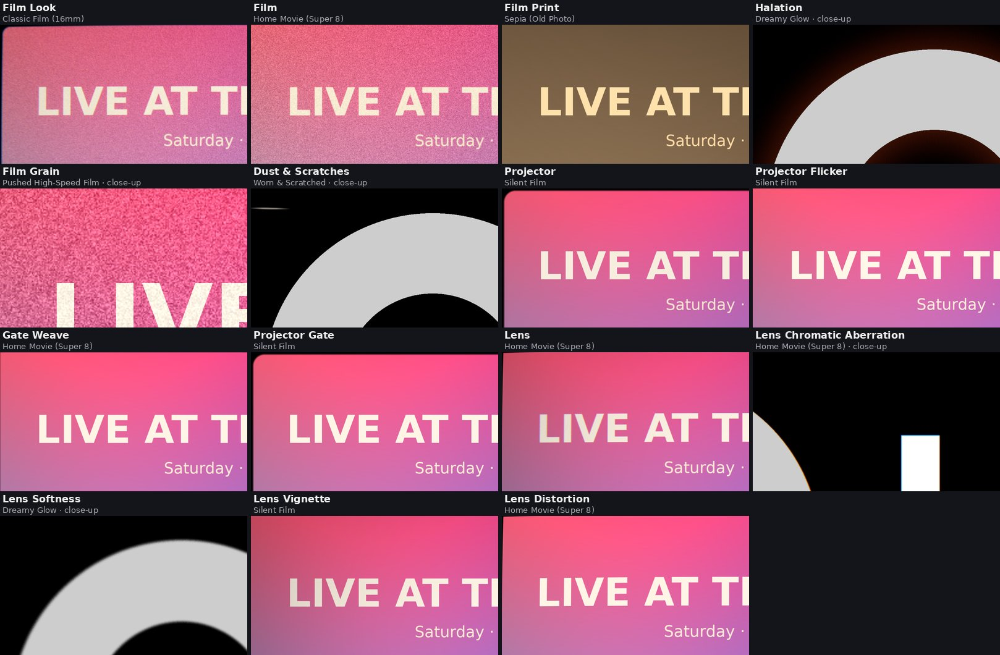

| Shader | What it does |
|---|---|
| **Film Look** | The whole projected-film look in one filter: film, projector and lens, each part with a tick, and 13 presets. |
| **Film** | Everything the film adds: Film Print, Halation, softness, Film Grain and Dust & Scratches in one pass. |
| Film Print | The print's tone and colour: contrast, a soft roll-off to white, fading, and colour, black and white, sepia or tints. |
| Halation | The warm halo film gives round bright parts. |
| Film Grain | Film grain that changes with brightness, in colour or not, at a film's frame rate. |
| Dust & Scratches | Specks of dust and scratches running down the print. |
| **Projector** | Everything the projector adds: Gate Weave, Projector Flicker and Projector Gate in one pass. |
| Gate Weave | The picture not sitting quite still, as film doesn't in a projector. |
| Projector Flicker | The lamp's and the film's brightness changing frame to frame, kept gentle. |
| Projector Gate | The soft, round-cornered edge of a projected frame. |
| **Lens** | Everything the lens does: Lens Distortion, edge softness, Lens Chromatic Aberration and Lens Vignette in one pass. |
| Lens Distortion | Straight edges bowing outwards or inwards. |
| Lens Chromatic Aberration | Colour fringes towards the edges. |
| Lens Softness | The picture softer overall or towards the corners. |
| Lens Vignette | Darker corners. |

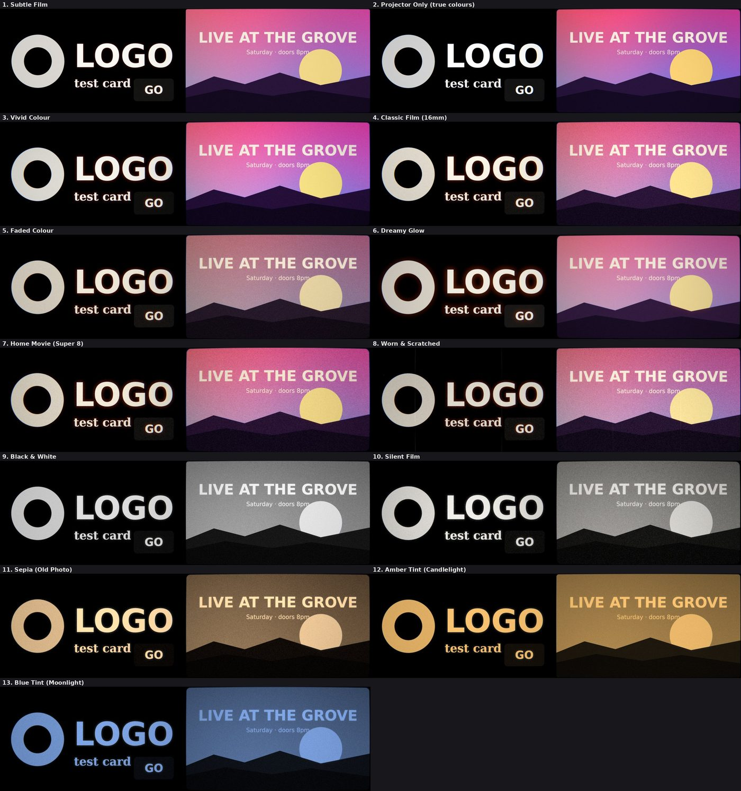

### VHS & CRT

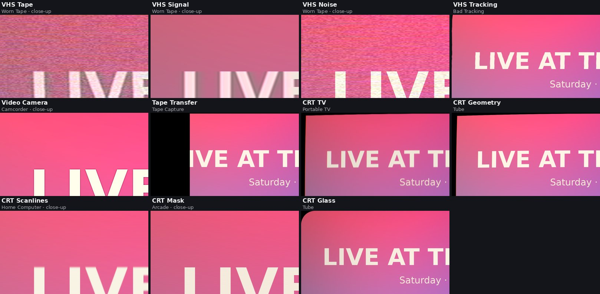

| Shader | What it does |
|---|---|
| **VHS Tape** | A whole VHS tape in one filter: VHS Signal, VHS Noise and VHS Tracking, with presets from broadcast to worn. |
| VHS Signal | The picture as a VHS recorder records it: soft detail and colour smeared sideways. |
| VHS Noise | Tape noise: streaks along the lines, blotches of colour, and specks of missing oxide. |
| VHS Tracking | The tape's unsteady timing: a slow waver, and the noise band of bad tracking. |
| Video Camera | The look of 1980s and 90s video cameras: outlined edges and hard, flat highlights. |
| Tape Transfer | The frame of a digitised tape: 4:3, with the dark edges of the signal a TV hid. |
| **CRT TV** | A whole picture-tube TV in one filter: CRT Geometry, CRT Scanlines, CRT Mask and CRT Glass. |
| CRT Geometry | The tube's curved picture and its colours landing slightly apart towards the edges. |
| CRT Scanlines | The picture drawn line by line, the lines fattening where it's bright. |
| CRT Mask | The red, green and blue phosphor dots, stripes or slots behind the glass. |
| CRT Glass | The glass face: a glow round bright parts, rounded corners and dimmer edges. |

| VHS Tape, Worn Tape | VHS Tape into CRT TV, Tube |
|---|---|
| 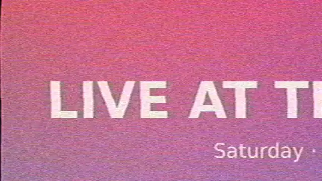 | 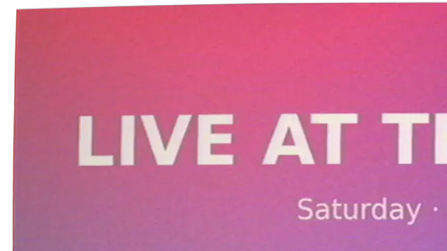 |

## Installation

The package mirrors OBS Studio's installation folder: copy its contents over an OBS Studio install (on Windows,
usually `C:\Program Files\obs-studio\`). The plugin goes in `obs-plugins/64bit/`, and its shaders and translations in
`data/obs-plugins/obs-shaderfilter/` (`examples/` and `locale/`).

## Using it

Add the filter to any source through "Filters" when right-clicking it; it is called "Shader". Choose a shader in the
**Shader** list, then a preset if it has them, and adjust from there. **Show Advanced Options** holds the rest, such as
"Add Space Around the Image" for effects that draw outside the source.

To use a shader of your own, pick **Other file…** in the Shader list. [DEVELOPING.md](DEVELOPING.md) explains how to
write one, and how to give a folder of your own shaders categories and presets.

The rest of the bundled shaders are in [data/examples](data/examples); many say at the top who wrote them or where
they're adapted from (often Shadertoy).

## Credits

- **[nleseul](https://github.com/nleseul/obs-shaderfilter)** wrote the original obs-shaderfilter.
- **[Exeldro](https://github.com/exeldro/obs-shaderfilter)** took it on from version 2 and built it into the plugin
  this fork starts from (setting annotations and groups, many of the standard parameters, and the bundled shader
  collection, gathered with their authors). If the plugin is useful to you, consider supporting Exeldro:
  [paypal.me/exeldro](https://www.paypal.me/exeldro).
- **Everyone who contributed upstream:** shaders, fixes and translations; see the
  [contributors](https://github.com/exeldro/obs-shaderfilter/graphs/contributors) and each shader's header.
- **This fork's changes** (listed [above](#what-this-fork-improves)) are xycoord's.

The plugin is under the GNU General Public License, version 2; see [LICENSE](LICENSE).
